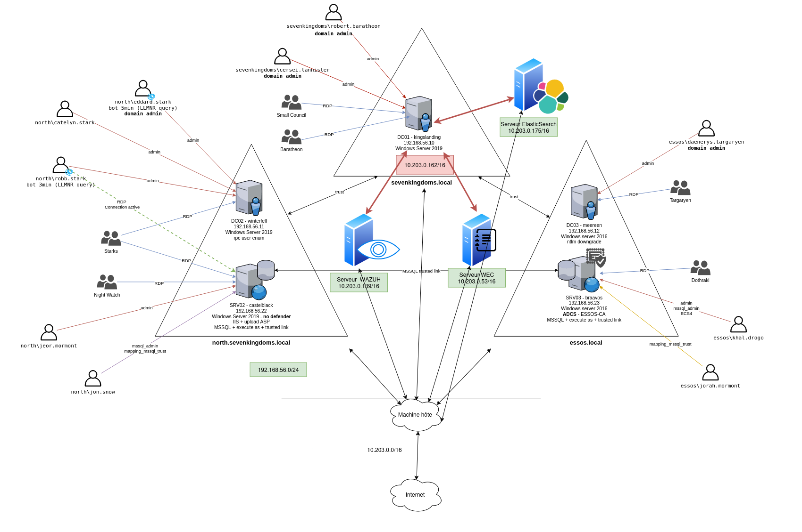

# SIEM Comparison on a GOAD Active Directory Lab

Which SIEM performs best when an Active Directory environment is under attack? This project deploys three log collection and detection solutions side by side on the same vulnerable lab, runs a set of attacks against it, and compares how each one detects and reports them.

The three solutions compared:

- **Wazuh** (SIEM / XDR, based on OSSEC)
- **ElasticSearch** with Kibana (ELK stack SIEM)
- **OpenWEC** (Windows Event Collector, open source, by CEA)

The vulnerable target is [GOAD (Game of Active Directory)](https://github.com/Orange-Cyberdefense/GOAD) by Orange Cyberdefense, a multi-domain AD lab.

> This is a lab study on an isolated, intentionally vulnerable environment built for defensive testing. Passwords shown in the original work have been redacted. Domain and host names come from GOAD and are fictional.

## Executive summary

This project answers a concrete business question: which SIEM gives the best detection for the lowest cost on a Windows and Active Directory estate. Three solutions (Wazuh, ElasticSearch, and OpenWEC) were deployed on the same intentionally vulnerable lab, subjected to the same set of attacks, and scored on detection coverage, usability, and total cost. Wazuh came out as the best fit for a small or medium business: it detected the widest range of attacks with the lowest hardware and skill requirements. The report below gives the comparison matrix, the per-attack detection results, and a costed recommendation.

## What a SIEM is

A Security Information and Event Management platform lets an organization detect threats and disruptions before they slow the business down. SIEMs work through agents (software) installed on the hosts to monitor. Each agent stays active while the host runs and reports activity back to the server for correlation and analysis.

## Supervised infrastructure

The lab is the standard GOAD topology (three domains: `sevenkingdoms.local`, `north.sevenkingdoms.local`, and `essos.local`), with three collectors added behind the host machine: a Wazuh server, an ElasticSearch server, and an OpenWEC server. Most attacks target `DC01` because all three collectors and their agents run on it, while Wazuh and ElasticSearch also have agents on the other machines to catch lateral movement.

See [docs/goad-lab.md](docs/goad-lab.md) for the lab breakdown.

## Attacks and detection

Each attack follows the same method: launch the attack, watch the logs reach the WEC / Wazuh / ElasticSearch servers, then analyze what each one captured. Full walkthrough with screenshots in [docs/attacks.md](docs/attacks.md).

| Attack | Tool | Wazuh | ElasticSearch | OpenWEC |
|--------|------|:-----:|:-------------:|:-------:|
| RDP brute force on DC01 | Hydra | Yes (most detail) | Yes | Yes |
| Port scan | Nmap (via Suricata) | Yes | Yes | No |
| Vulnerability scan | Nessus | Yes | - | - |
| Denial of service | Hping3 | Yes | No | No |
| Web enumeration / attacks | OWASP ZAP + Spider | Yes | - | - |

Key finding: OpenWEC only reports host-level Windows events (for example process creation), because it has no Suricata integration and therefore does not surface network-based events such as Nmap scans or DoS. Wazuh and ElasticSearch, which include network monitoring, catch far more.

## Comparison matrix

| Criterion | Wazuh | ElasticSearch | OpenWEC |
|-----------|-------|---------------|---------|
| Base | OSSEC | ELK stack | Modular framework |
| Deployment | Easy, several modules | Easy, ELK integrations | Specific install, depends on components |
| Scalability | Good (distributed agents) | Excellent | Medium |
| Intrusion detection (IDS) | Core feature, real time | Needs extra config | Not a core function |
| File integrity monitoring | Yes | Needs extra tools | No |
| Alerting | Real time, predefined and custom rules | Watcher or custom scripts | Scripts or third-party |
| Dashboards | Kibana or Wazuh UI | Native Kibana | Basic / plugins |
| Compliance reports | PCI-DSS, HIPAA, GDPR | Needs integrations | Windows event storage only |
| Cost | Free (open source) | Free (premium options paid) | Free |
| Community / docs | Large, complete | Large, premium support | Smaller, variable |
| Ease of configuration | Relatively easy | More complex (ELK knowledge) | Manual, more technical skill |

### Scoring

| Score | Comment |
|-------|---------|
| Wazuh 4.8/5 | Very easy to use, well packaged, clear support, logs detailed enough to reverse engineer an attack |
| ElasticSearch 4/5 | More complex, large integration library, documentation not always clear, needs advanced skills, many technologies to combine, very complete logs |
| OpenWEC 3/5 | Only reports system information such as process launches, command-line interface, needs an added GUI and a log parser to stay human readable |

## Cost estimate

Human cost was tracked over 14 days (7h/day) split between a system administrator and a SOC analyst. On the material side, Wazuh and OpenWEC each need one server, while ElasticSearch needs five, which makes it far more expensive to run.

Recommendation for a small or medium business: **Wazuh**. It is the middle ground between a large-enterprise solution and a small-shop one, easy to install and configure, with enterprise support available. ElasticSearch demands too many hardware and human resources and targets large enterprises, while OpenWEC is complex for limited, mostly local features.

## Repository layout

| Path | Contents |
|------|----------|
| [docs/goad-lab.md](docs/goad-lab.md) | GOAD lab, domains, hosts, install |
| [docs/attacks.md](docs/attacks.md) | Attacks run and per-SIEM detection analysis |
| [docs/wazuh.md](docs/wazuh.md) | Wazuh install, GPO agent deployment, Sysmon integration |
| [docs/elasticsearch.md](docs/elasticsearch.md) | ElasticSearch + Kibana install, Fleet, Sysmon logs |
| [docs/openwec.md](docs/openwec.md) | OpenWEC install and Windows Event Forwarding configuration |
| [docs/suricata.md](docs/suricata.md) | Suricata IDS role for network detection |

## Skills demonstrated

SIEM deployment and tuning (Wazuh, ELK, OpenWEC), Active Directory log collection, GPO-based agent deployment, Sysmon and Windows Event Forwarding, attack simulation (brute force, scanning, DoS, web attacks), and detection analysis.
