# Attacks on GOAD and detection analysis

This document details the attacks run against the GOAD lab that was set up with the three collectors (Wazuh, OpenWEC, ElasticSearch), so the events can be surfaced in the logs and analyzed.

Most attacks target DC01 because all three collectors and their agents run on it. Wazuh and ElasticSearch also have agents on the rest of the machines to surface and analyze logs during lateral movement. Attacks are launched from a Kali machine at 10.203.0.197.

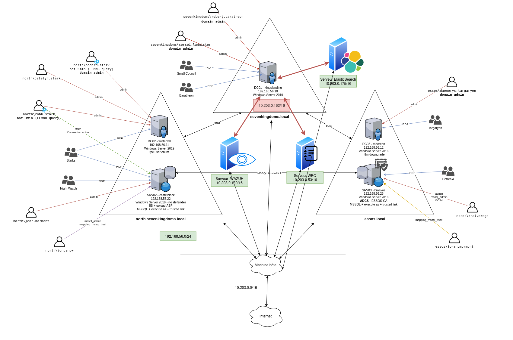

Method for each attack:

1. Launch the attack or exploit
2. Watch the log reach the WEC / Wazuh / ElasticSearch servers
3. Analyze the log across the three SIEMs

## 1. RDP brute force on DC01 (Hydra)

Brute force against DC01 RDP with the username "username" and random passwords.

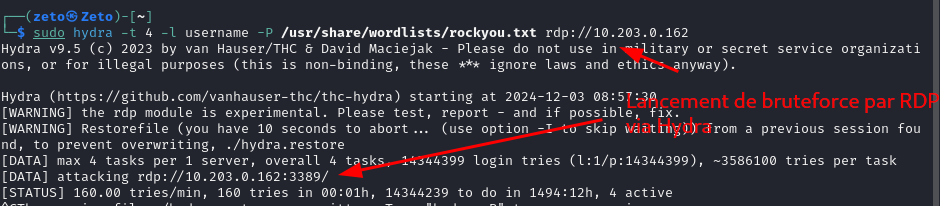

### OpenWEC

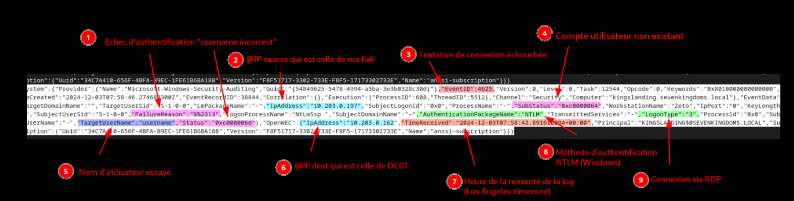

Points of interest: the tested username, source IP, destination IP, the fact that the account does not exist (during reverse engineering this suggests the attacker has no prior info on the machine), and the attack timestamp. With an existing username, the "non existent" code turns into a code ending in `6a`, meaning wrong password, which tells the attacker the account is valid.

### Wazuh

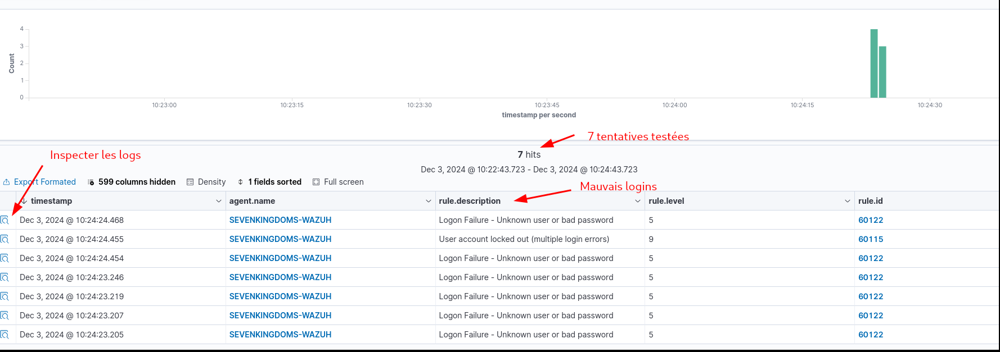

Clicking "inspect" on the left shows the same information as the WEC server, with extra detail:

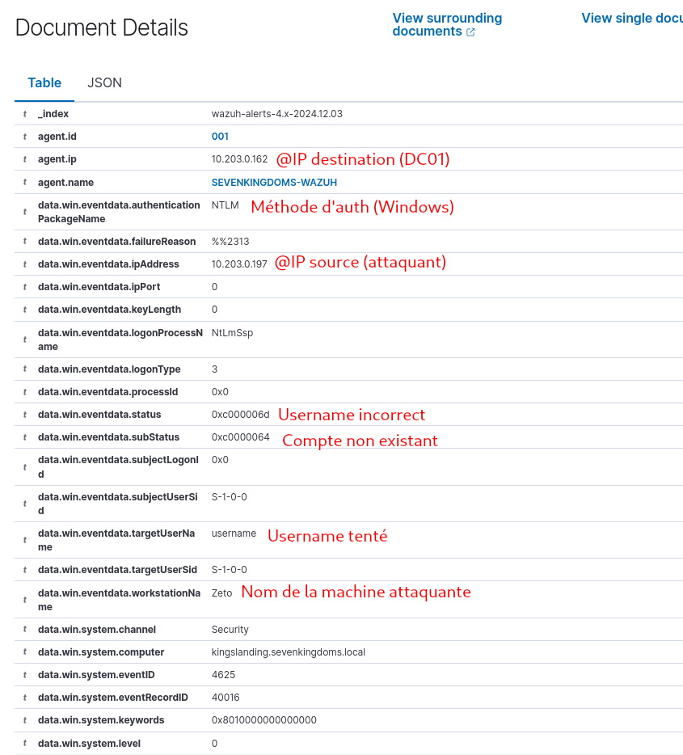

Wazuh shows more, including the message returned by the machine:

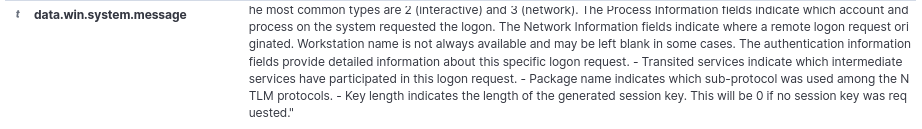

### ElasticSearch

Logs come through with a lot of information:

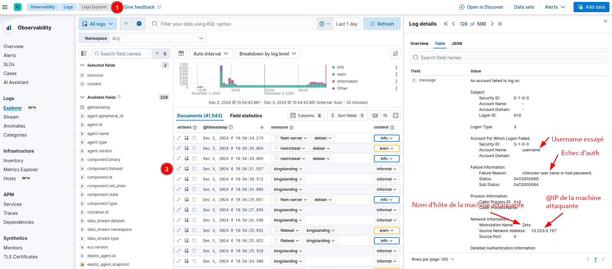

## 2. Nmap port scan (via Suricata)

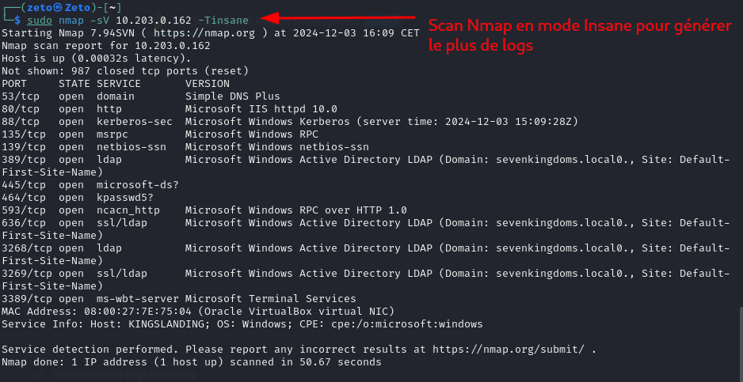

### Wazuh

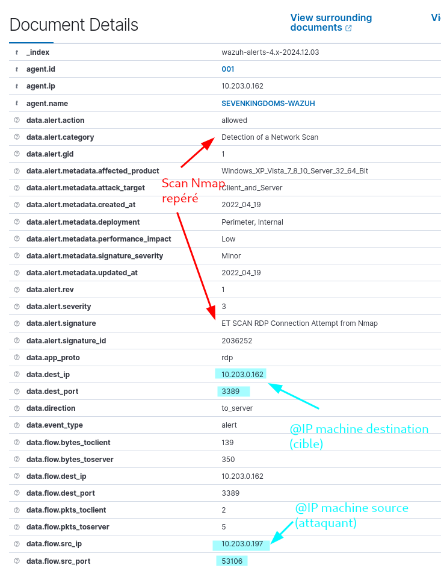

### ElasticSearch

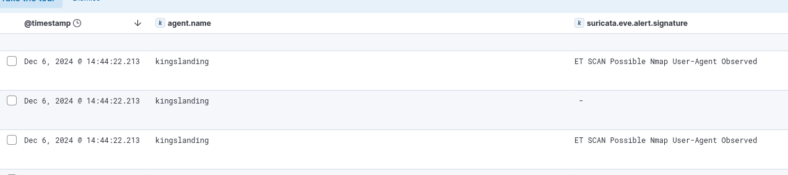

The Nmap scan is surfaced by both SIEMs.

### OpenWEC

OpenWEC does not surface the Nmap scan, because it has no Suricata integration and only reports host-level Windows events, not network events.

## 3. Nessus advanced scan

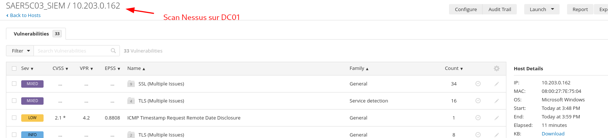

Detected by Wazuh:

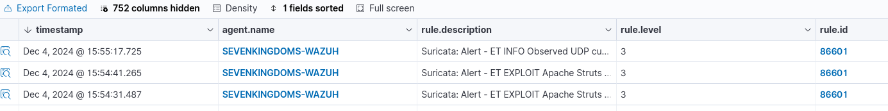

## 4. Denial of service (Hping3)

An Hping3 attack sends packets from random source IPs to port 80 of 10.203.0.162.

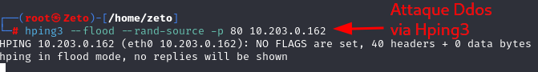

- **OpenWEC**: events not surfaced.
- **Wazuh**: detected.

  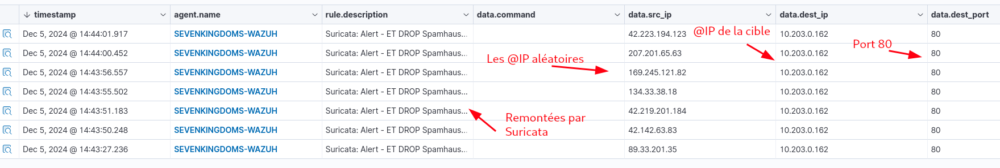
- **ElasticSearch**: logs not surfaced.

## 5. Web scan with OWASP ZAP + Spider

ZAP enumerates hidden directories and files with wordlists. The Spider function lets ZAP test web attacks such as SQL injection and XSS. The site has no forms to submit, so the injections did not go through.

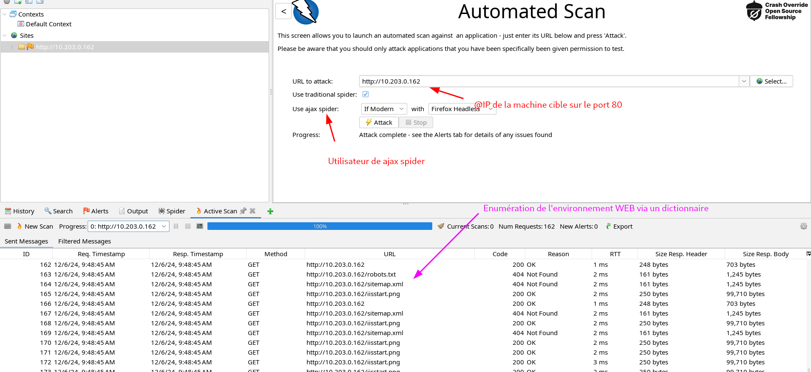

### Wazuh

The enumeration is caught by the Wazuh agent:

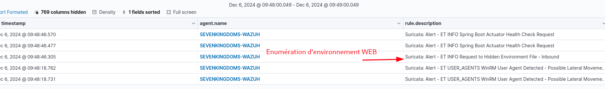
