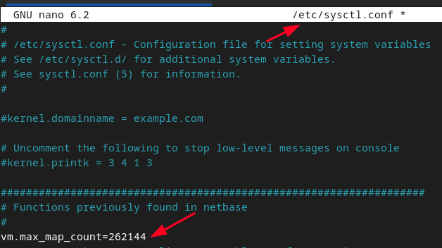
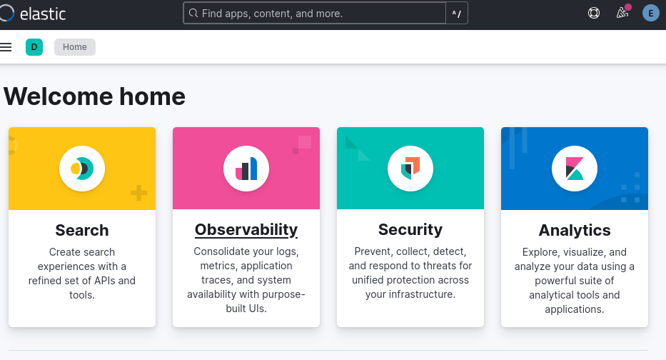
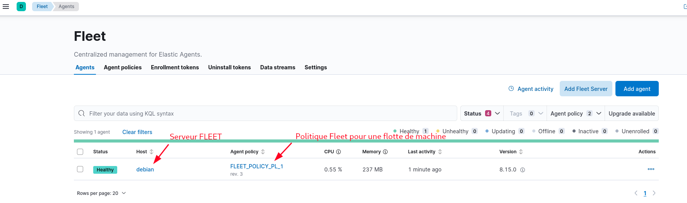
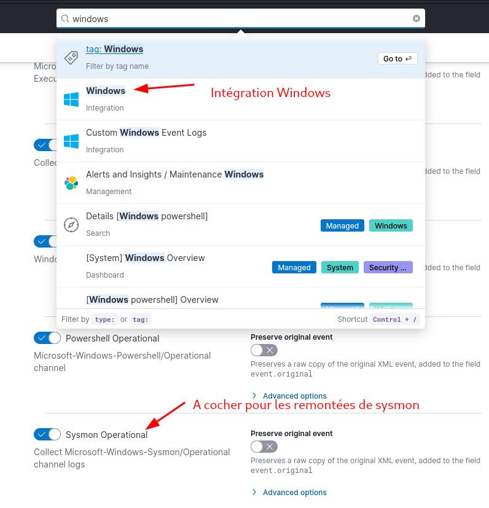
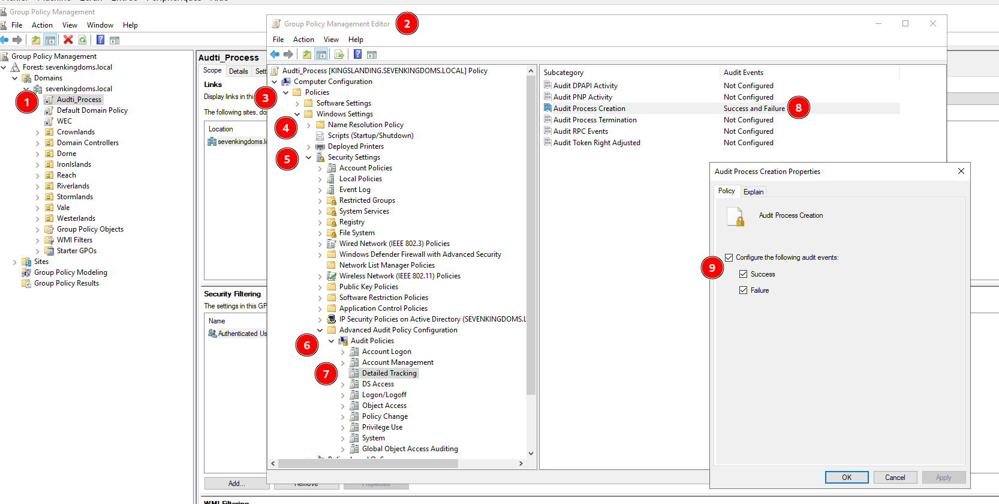
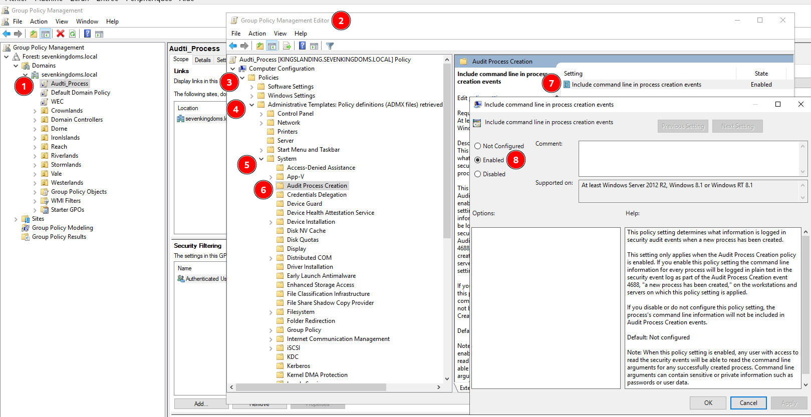
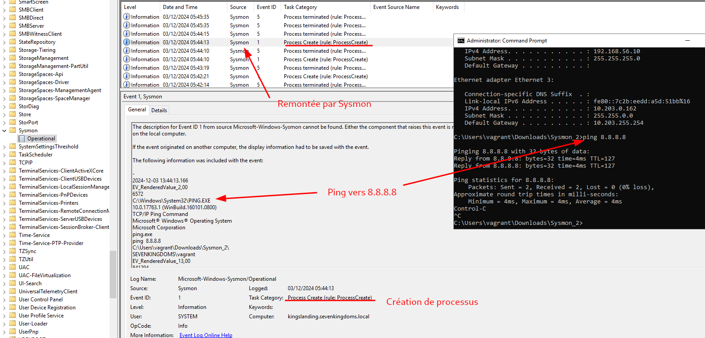
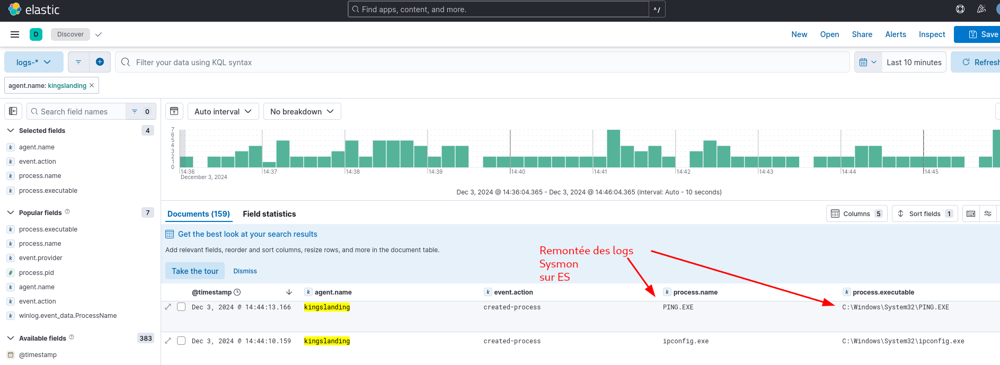

# ElasticSearch server (with Kibana)

In production, applications, servers, and operating systems generate logs (text files with events and errors). These logs quickly grow large and hard to manage. ElasticSearch centralizes, indexes, and stores them, while Kibana explores and visualizes the data interactively.

## Install ElasticSearch

Minimum 16 GB of RAM on the machine.

Install Docker and clone an Elastic SIEM stack:

```bash
apt update && apt upgrade            # update packages
apt install docker                   # install docker
apt install docker-compose           # install docker-compose
apt install git                      # install git
git clone <elastic-siem-repo>        # Elastic SIEM, Suricata, Evebox, Zeek
apt install make
apt install curl
```

Edit `/etc/sysctl.conf` to raise the number of virtual memory maps, since several containers will run:



Apply the change with `sysctl -p`.

In the cloned `siem` directory run `make es`, then `make fleet`, then `make siem`, and finally `make pass` to get the passwords.

```text
password elastic= <redacted>
password kibana= <redacted>
password beats_system= <redacted>
password apm_system= <redacted>
password remote_monitoring_user= <redacted>
```



Add Fleet so you can monitor fleets of machines, starting with a Fleet server:



## Sysmon logs in ElasticSearch

Add the "Windows" integration and make sure "Sysmon Operational" is checked:



Install Sysmon from Microsoft, open a CMD in the Sysmon directory, and run:

```cmd
Sysmon.exe -i -accepteula
```

Enable process command-line auditing by GPO:



Also enable process creation auditing by GPO:



Sysmon logs then come through in ElasticSearch:



