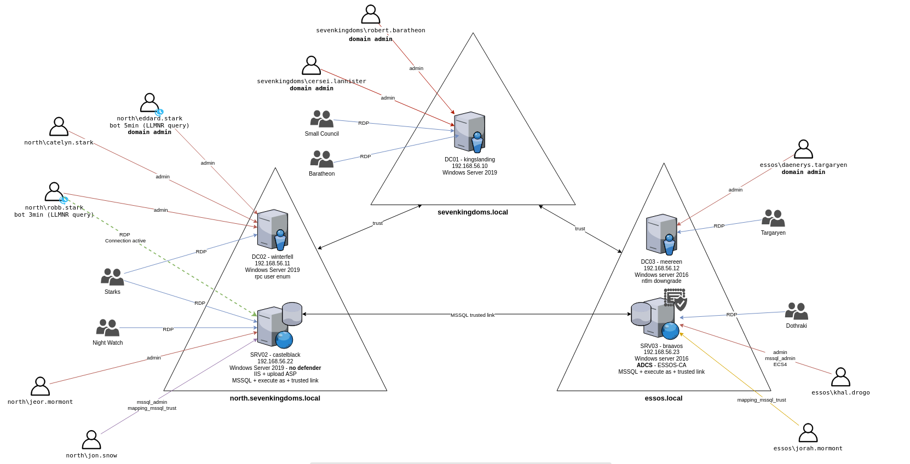
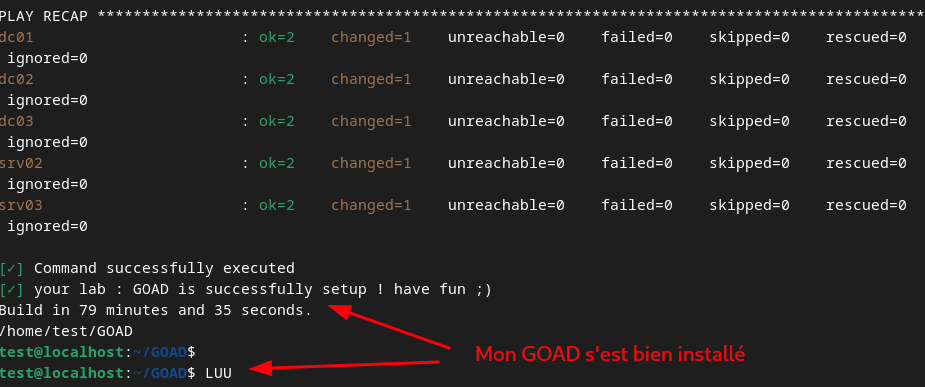
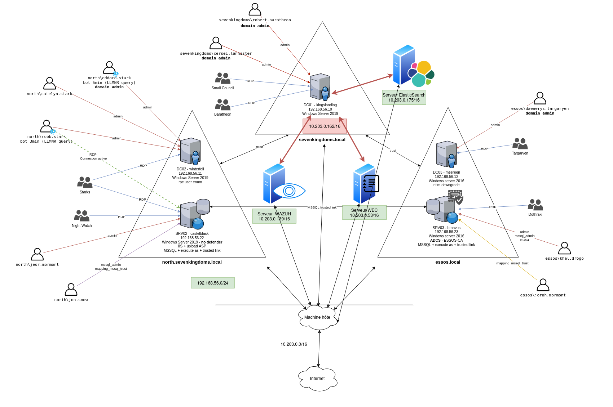

# GOAD lab

This project uses the GOAD (Game of Active Directory) environment by Orange Cyberdefense as the target infrastructure.



## Install

Clone the GOAD repository:

https://github.com/Orange-Cyberdefense/GOAD

Check the project dependencies:

```bash
./goad.sh -t check -l GOAD -p virtualbox -m local
```

Then install the whole infrastructure:

```bash
./goad.sh -t install -l GOAD -p virtualbox -m local
```



Two servers were added to the environment (which is NATed behind the host machine):

- An OpenWEC server at 10.203.0.53
- A Wazuh server at 10.203.0.139

Full supervised environment:



## Contents of GOAD

Three domains: `north.sevenkingdoms.local`, `sevenkingdoms.local`, and `essos.local`.

### north.sevenkingdoms.local

- Domain controller `DC02 winterfell`, Windows Server 2019, 192.168.56.11
- MSSQL database server `SRV02 castelblack`, 192.168.56.22
- Domain admin accounts, one of which is both domain admin and has RDP on the database server
- Standard user accounts with RDP on the DC and database server
- A database server administrator account and a database administrator account

### sevenkingdoms.local

- Domain controller `DC01 kingslanding`, Windows Server 2019, 192.168.56.10
- Two domain admin accounts
- Two standard accounts with RDP on the DC

This domain and the north domain share a **bidirectional trust**, which allows resource access between the two (an offensive and defensive angle for both attackers and defenders).

### essos.local

- Domain controller `DC03 meereen`, Windows Server 2016 (an older version than the other DCs)
- A server hosting:
  1. **ADCS** (Active Directory Certificate Services), a certificate authority that issues certificates across the AD-linked services, users, and servers to prove identity
  2. **MSSQL** database service
- Standard user accounts with RDP on the servers
- Admin accounts (one for the DC, one for ADCS)
- An MSSQL user account
