# OpenWEC server

A WEC (Windows Event Collector) server is a component of the Windows ecosystem used to collect and centralize event logs from several machines. OpenWEC is an open source implementation by CEA.

## Install

OpenWEC repository: https://github.com/cea-sec/openwec/blob/main/doc/getting_started.md

Install cargo first:

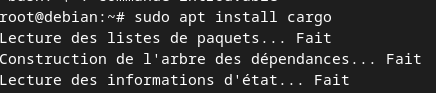

Then build and install:

```bash
adduser openwec                                   # create the openwec account
cargo build --release
cp ./target/release/openwecd /usr/local/bin/      # daemon binary
cp ./target/release/openwec /usr/local/bin/       # CLI binary
systemctl edit openwec.service --full --force     # edit the systemd unit
```

A `libgssapi` error can occur. Install the dependency:

```bash
sudo apt install -y libclang-dev clang
```

`openwec.service`:

```ini
[Unit]
Description=Windows Events Collector
After=network.target
[Service]
Type=simple
User=openwec
Restart=always
RestartSec=5s
ExecStart=/usr/local/bin/openwecd -c /etc/openwec/openwec.conf.toml
[Install]
WantedBy=multi-user.target
```

Apply ownership to the openwec user and group:

```bash
chown -R openwec:openwec /var/db/openwec
```

After installing the dependency, point Rust to it by setting the environment variable to its path:

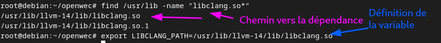

## Kingslanding (DC01) configuration

1. Add a DNS record `wec.sevenkingdoms.local` for the OpenWEC server. On DC01, in the DNS configuration for `sevenkingdoms.local`, add an A record pointing to the OpenWEC server:

   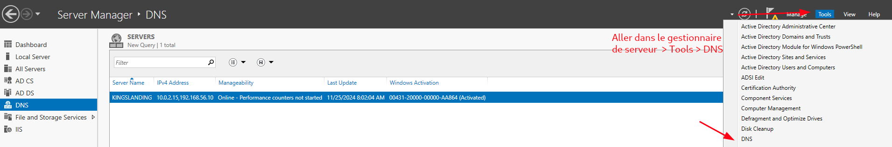
   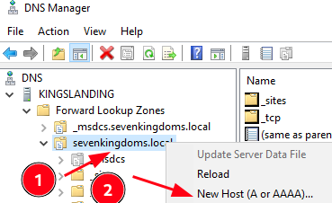
   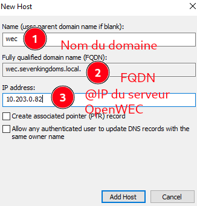

   Test with a ping:

   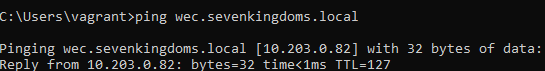

2. Create a `wec` service user in AD:

   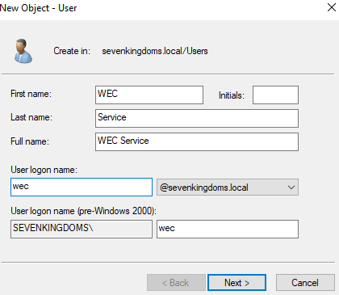
   

   Add an HTTP SPN (Service Principal Name) for WEC from a PowerShell console:

   ```powershell
   setspn -A http/wec.sevenkingdoms.local@SEVENKINGDOMS.LOCAL sevenkingdoms\wec
   ```

   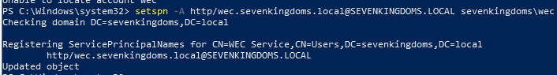

3. Generate a `.keytab` for `http/wec.sevenkingdoms.local` on the Kerberos server (DC01). From an admin CMD:

   ```cmd
   ktpass /princ http/wec.sevenkingdoms.local@SEVENKINGDOMS.LOCAL /mapuser wec@SEVENKINGDOMS.LOCAL /ptype KRB5_NT_PRINCIPAL /pass <password> /out wec.sevenkingdoms.local.keytab
   ```

   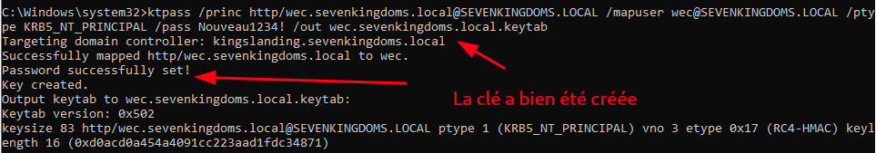

   Copy the file from DC01 to the OpenWEC server with scp:

   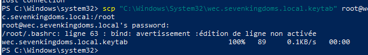

   Place the key in `/etc/` and set the permissions on the OpenWEC server:

   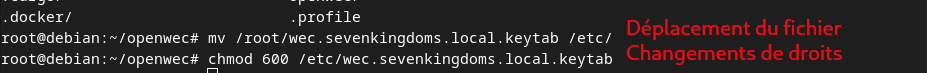

   Create `/etc/openwec.conf.toml`:

   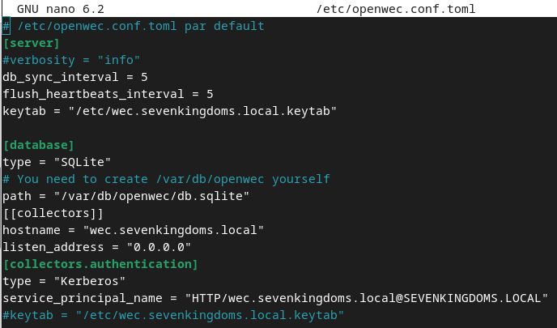

   Download the ANSSI OpenWEC configuration:

   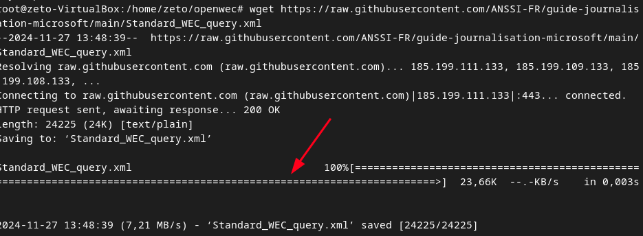

   Enable the ANSSI subscription:

   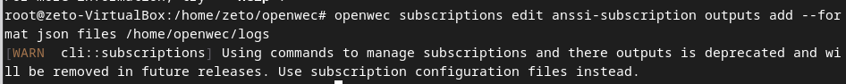
   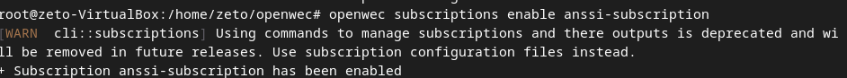

4. Create a GPO to forward the event logs:

   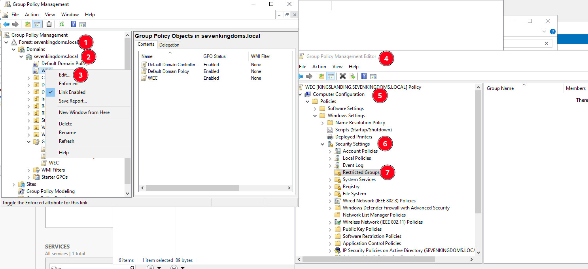

   Add `Event Log Readers` as a group:

   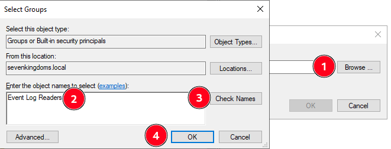

   Add `NETWORK SERVICE` as a member:

   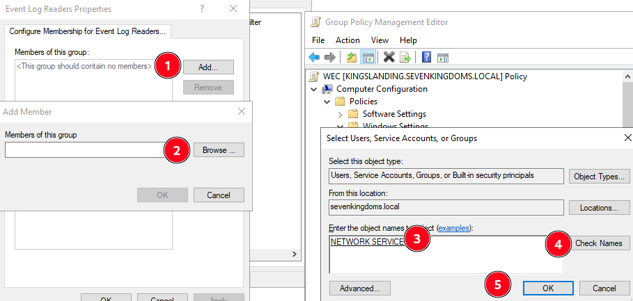
   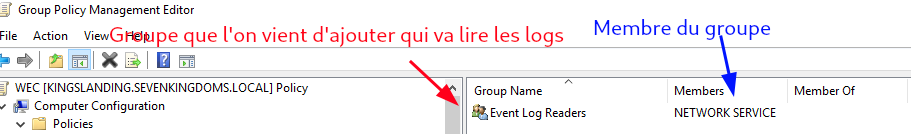

   Configure WinRM to start automatically on the machines:

   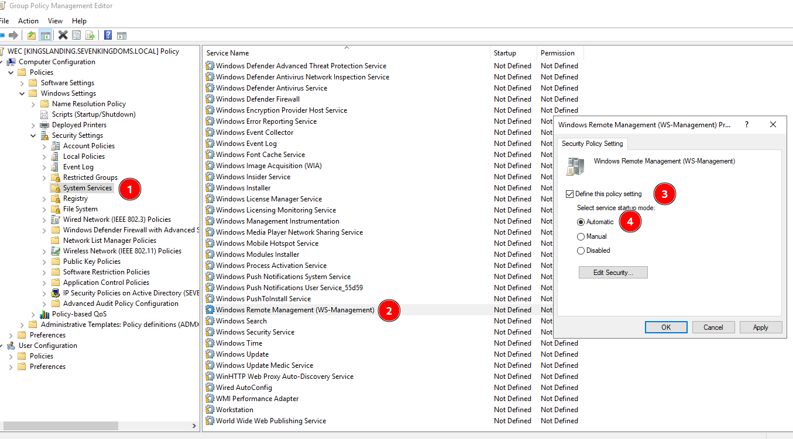

   Subscribe the machine to the WEC server so it sends logs:

   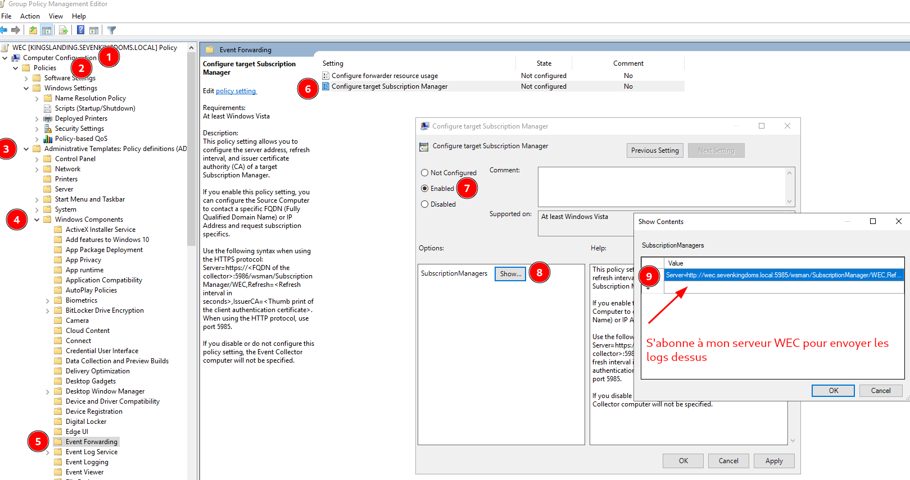

   ```text
   Server=http://wec.sevenkingdoms.local:5985/wsman/SubscriptionManager/WEC,Refresh=60
   ```

   Obtain the base SDDL to grant log access rights to the EventLogReader group and the NetworkService user:

   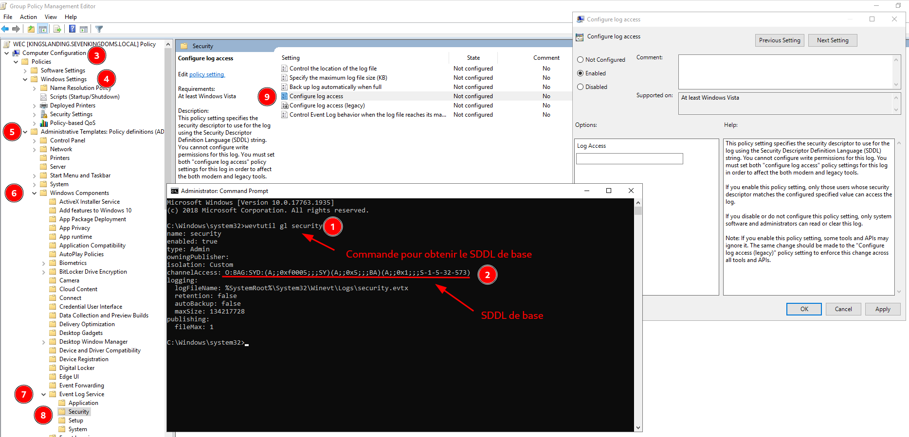

   ```text
   O:BAG:SYD:(A;;0xf0005;;;SY)(A;;0x5;;;BA)(A;;0x1;;;S-1-5-32-573)
   ```

   SDDL breakdown:
   - `O:BA` owner is the Administrators group, `G:SY` primary group is Local System.
   - `(A;;0xf0005;;;SY)` allow full advanced access to Local System (S-1-5-18) on this event channel.
   - `(A;;0x5;;;BA)` allow read and channel management to Administrators.
   - `(A;;0x1;;;S-1-5-32-573)` allow simple read to Event Log Readers (SID S-1-5-32-573).

   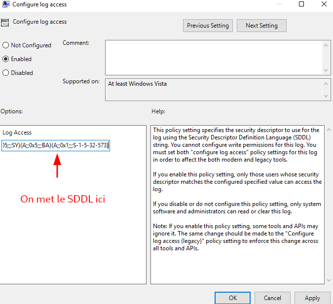

   Force GPO propagation and list applied GPOs:

   ```powershell
   gpupdate /force   # force propagation
   gpresult /R       # list applied GPOs
   ```

   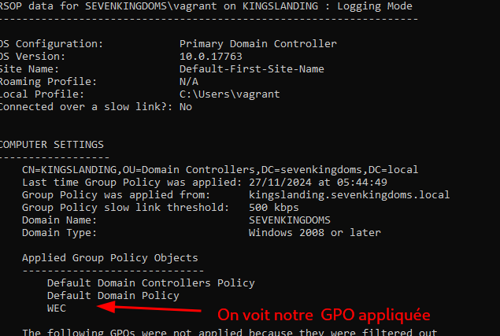

5. Launch a `notepad` process on the Windows machine to generate a log:

   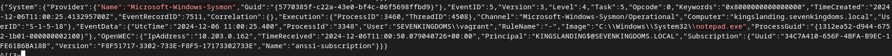

   The log is received on the OpenWEC server:

   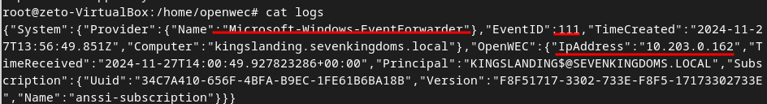
