# Wazuh server

Wazuh is an open source security monitoring platform providing SIEM capabilities to help organizations monitor, analyze, and respond to security incidents. At its core it is an intrusion detection system (IDS) and a log management platform.

Here Wazuh is installed alongside an OpenWEC server to compare detection between the two.

| Feature | OpenWEC | Wazuh |
|---------|---------|-------|
| Main purpose | Windows event collection and management | Full SIEM (collection, intrusion detection, log management) |
| Platform | Windows only | Multi-platform (Windows, Linux, macOS) |
| Intrusion detection (IDS) | Not a core function | Core function, real-time detection |
| File monitoring | None | File and configuration integrity monitoring |
| Compliance | Collects and stores Windows events for compliance analysis | Compliance reports (PCI-DSS, HIPAA, GDPR) |
| Extensibility | Mainly integrates with other tools for Windows event analysis | Highly extensible (SIEM integrations, plugins) |
| Dashboards | Limited | Kibana integration for interactive dashboards |

## Install

Install the Wazuh OVA:

https://documentation.wazuh.com/current/deployment-options/virtual-machine/virtual-machine.html

## Add an agent

Go to Server management > Endpoints Summary > Deploy new agent:

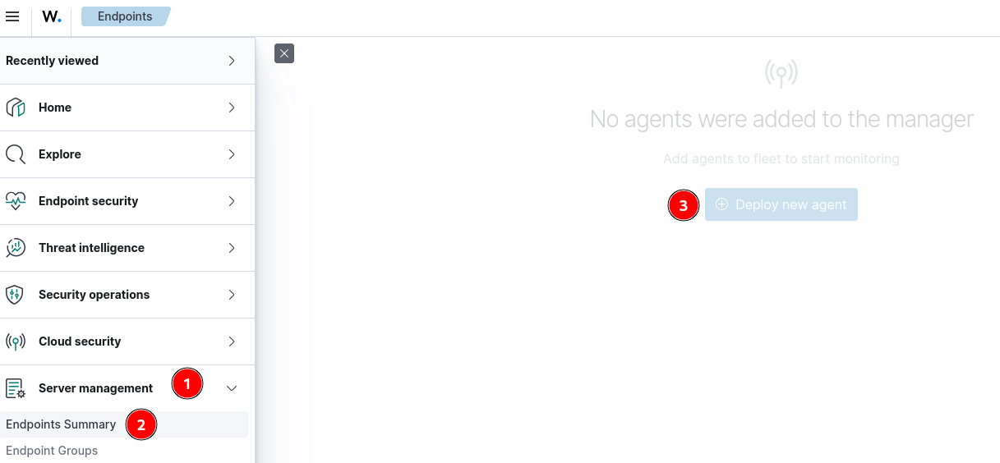

Set the architecture (here Windows), the Wazuh server IP, and the agent name:

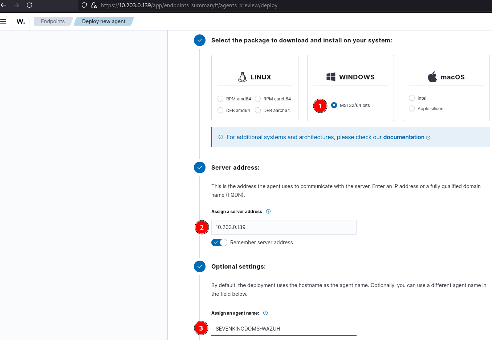
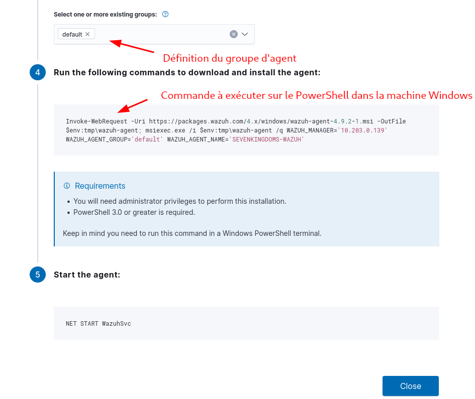

Start the agent. It reports in:

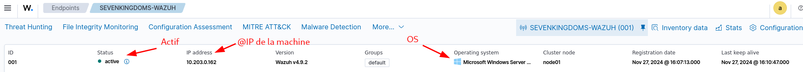

## Automated Wazuh agent deployment by GPO

Wazuh documents GPO deployment here: https://wazuh.com/blog/deploying-wazuh-agent-using-windows-gpo/

First enable password authentication in `/var/ossec/etc/ossec.conf` (root only):

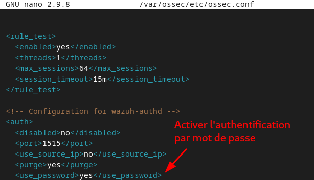

Create `authd.pass` in `/var/ossec/etc` and write a password into it:

```bash
echo <your-password> > /var/ossec/etc/authd.pass
```

Change the file owner and permissions:

```bash
chmod 640 /var/ossec/etc/authd.pass
chown root:wazuh /var/ossec/etc/authd.pass
```

Install the Orca binary (install the Windows SDK first):

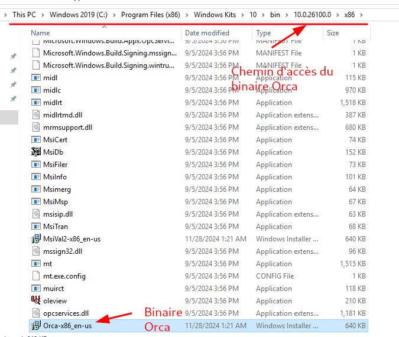

Select the Wazuh agent installer to modify it:

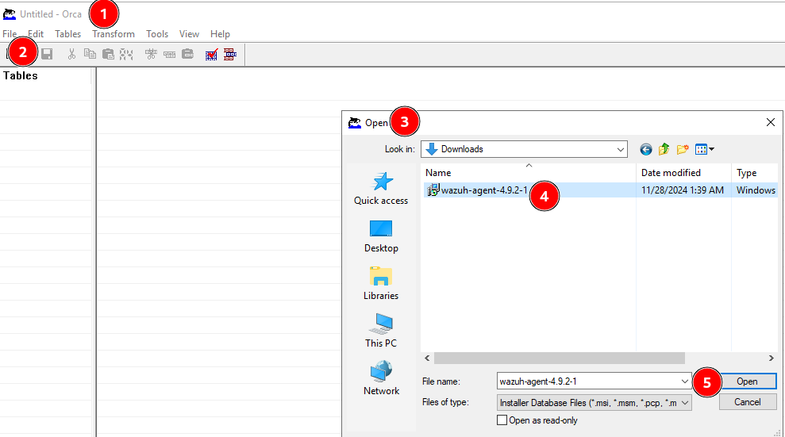

New transform to start editing the binary:

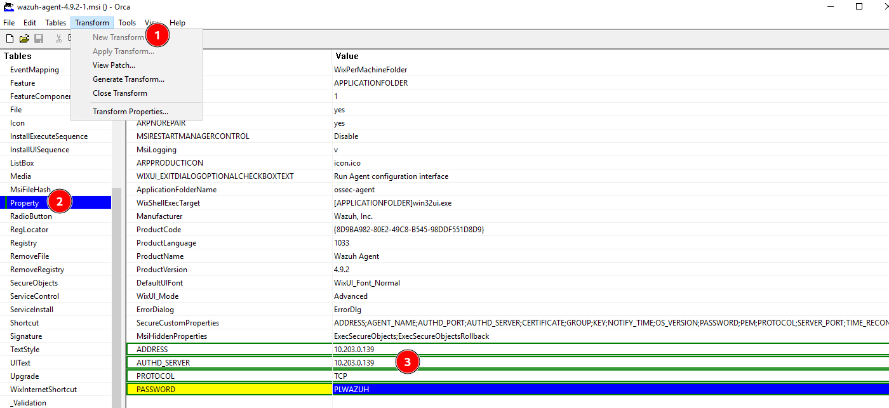

Add variables to the binary:

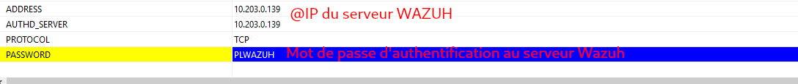

Generate the new `.mst` binary:

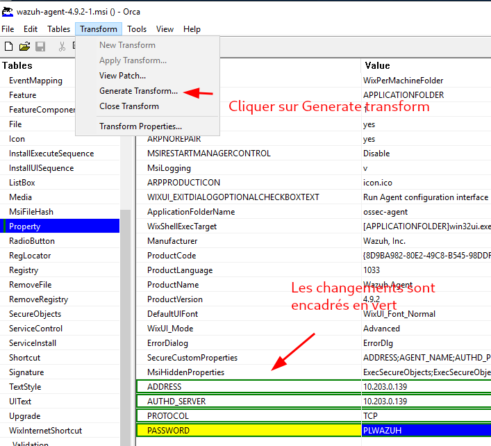

Create a shared directory to apply the GPO to all domain machines (authenticated users need read/write permission):

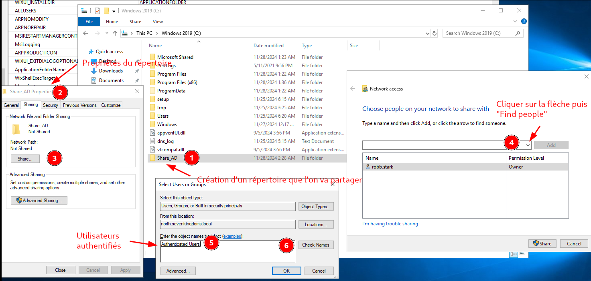
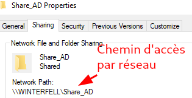

Create a `Wazuh` OU in AD and move the machine into it:

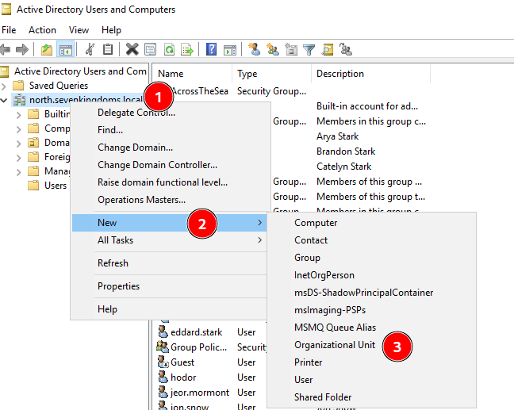
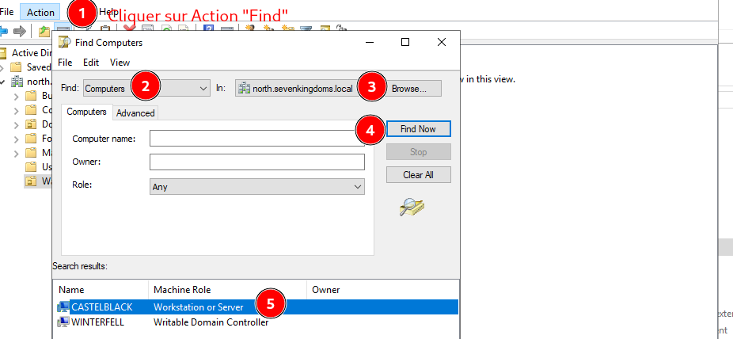

Add the Wazuh agent install package to the GPO plus the modified config:

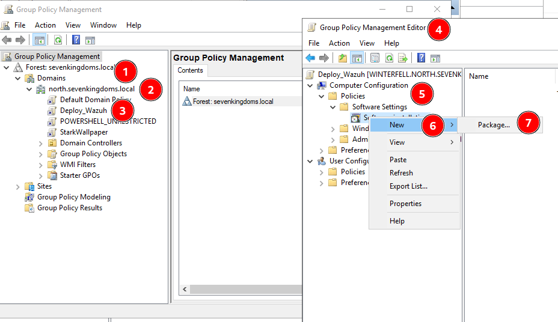
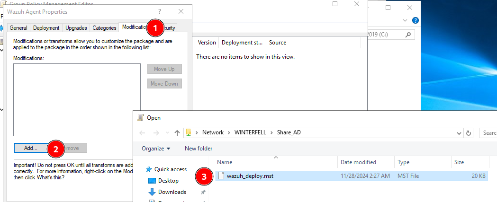
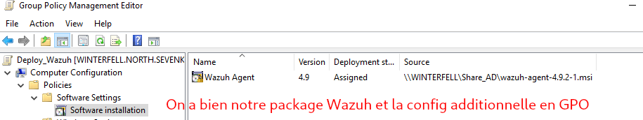

Force GPO propagation:

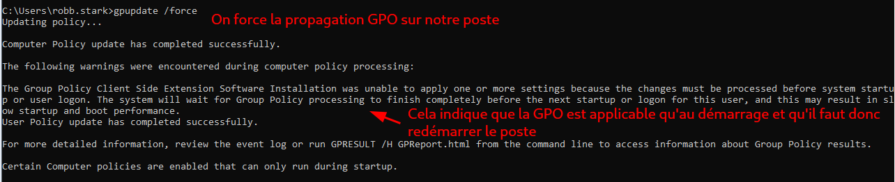

### Auto-start the agent by GPO

Create a GPO so the Wazuh agent starts automatically at boot:

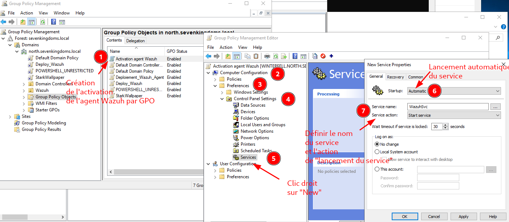

If the service does not run, restart it via the Recovery tab, "Restart the service":

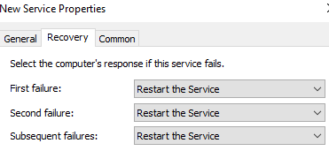

Wazuh then installs on all machines at boot and the service starts automatically. Verify with `gpresult /R`:

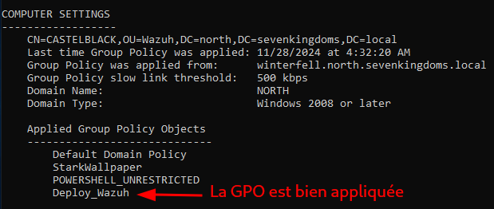
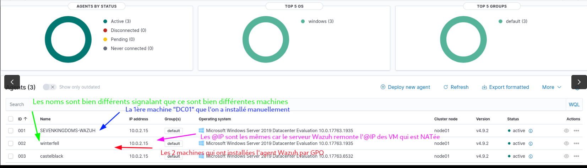

All machines across the three domains now report in for monitoring:

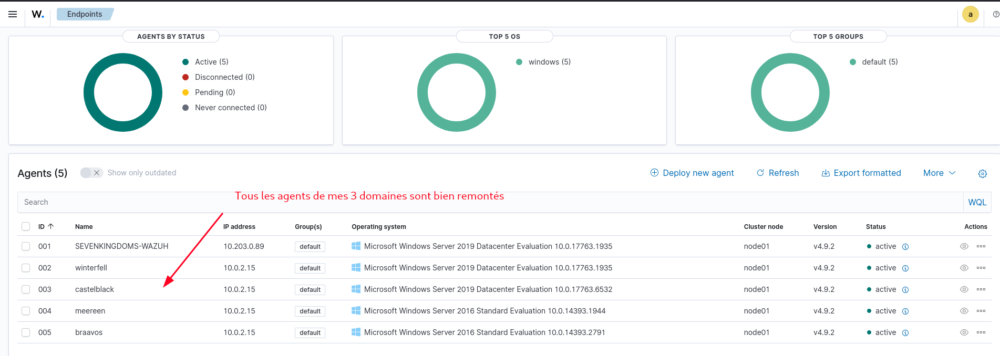

## Sysmon logs with Wazuh

To surface Sysmon logs in Wazuh:

1. Download Sysmon from Microsoft.
2. Edit the `ossec.conf` of the installed Wazuh agent in `C:\Program Files (x86)\ossec-agent`. Copy the file to the Desktop, edit it, and put it back, since writing in place is blocked. Back up the file before editing.

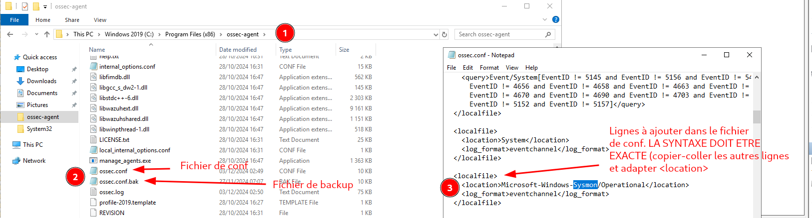

3. In the Sysmon install directory, create `sysconfig.xml` and place it next to the Sysmon binaries:

```xml
<Sysmon schemaversion="4.10">
   <HashAlgorithms>md5</HashAlgorithms>
   <EventFiltering>
      <!--SYSMON EVENT ID 1 : PROCESS CREATION-->
      <ProcessCreate onmatch="include">
         <Image condition="contains">mimikatz.exe</Image>
      </ProcessCreate>
      <!--SYSMON EVENT ID 2 : FILE CREATION TIME CHANGED-->
      <FileCreateTime onmatch="include" />
      <!--SYSMON EVENT ID 3 : NETWORK CONNECTION INITIATED-->
      <NetworkConnect onmatch="include" />
      <!--SYSMON EVENT ID 5 : PROCESS ENDED-->
      <ProcessTerminate onmatch="include" />
      <!--SYSMON EVENT ID 6 : DRIVER LOADED-->
      <DriverLoad onmatch="include" />
      <!--SYSMON EVENT ID 7 : DLL (IMAGE) LOADED-->
      <ImageLoad onmatch="include" />
      <!--SYSMON EVENT ID 8 : REMOTE THREAD CREATED-->
      <CreateRemoteThread onmatch="include">
         <SourceImage condition="contains">mimikatz.exe</SourceImage>
      </CreateRemoteThread>
      <!--SYSMON EVENT ID 9 : RAW DISK ACCESS-->
      <RawAccessRead onmatch="include" />
      <!--SYSMON EVENT ID 10 : INTER-PROCESS ACCESS-->
      <ProcessAccess onmatch="include">
         <SourceImage condition="contains">mimikatz.exe</SourceImage>
      </ProcessAccess>
      <!--SYSMON EVENT ID 11 : FILE CREATED-->
      <FileCreate onmatch="include" />
      <!--SYSMON EVENT ID 12/13/14 : REGISTRY MODIFICATION-->
      <RegistryEvent onmatch="include" />
      <!--SYSMON EVENT ID 15 : ALTERNATE DATA STREAM CREATED-->
      <FileCreateStreamHash onmatch="include" />
      <PipeEvent onmatch="include" />
   </EventFiltering>
</Sysmon>
```

4. Run an admin CMD in the directory:

```cmd
Sysmon64.exe -accepteula -i sysconfig.xml
```

5. On the Wazuh server, add to `/var/ossec/etc/rules/local_rules.xml`, then restart `wazuh-manager`:

```xml
<localfile>
  <location>Microsoft-Windows-Sysmon/Operational</location>
  <log_format>eventchannel</log_format>
</localfile>
```

6. Install Mimikatz (disable antivirus and firewall) and run the executable:

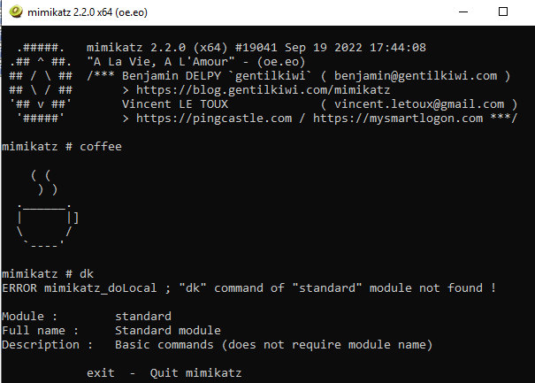

7. Open Event Viewer > Apps and Services > Microsoft > Windows > Sysmon > Operational:

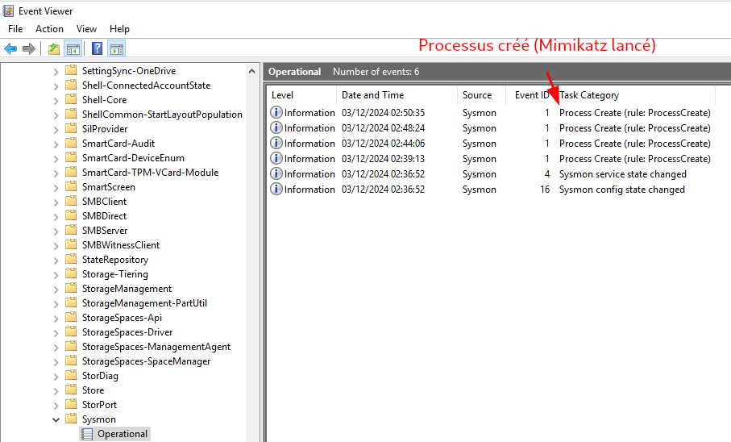

The log comes through in Wazuh:

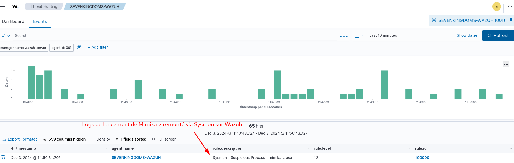
